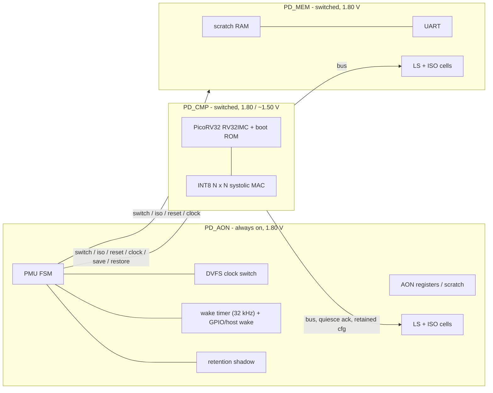

# Power-Managed Edge-AI SoC

A small RISC-V SoC with an INT8 systolic matrix-multiply accelerator and three
power domains, built and verified entirely with open-source tools from a
Windows laptop. The always-on domain's PMU sequences power gating, state
retention and two-point DVFS; the design is verified with a class-based
SystemVerilog testbench, bound assertions, X-aware power simulation, a
power-aware gate-level simulation of the Sky130 netlist and an unbounded formal
proof, then synthesised and placed and routed for Sky130 (and ASAP7 for a
multi-Vt study) with OpenROAD in GitHub Actions.



| State | PD_CMP | PD_MEM | Clock | Wake |
| --- | --- | --- | --- | --- |
| ACTIVE_H | on, 1.80 V | on | f (50 MHz) | - |
| ACTIVE_L | on, ~1.50 V | on | f / 2 | - |
| IDLE | off, isolated | on (RAM kept) | - | timer, GPIO, host |
| SLEEP | off, isolated | off, isolated | - | timer, GPIO, host |

## What is in here

| Area | Contents | Status |
| --- | --- | --- |
| RTL | `rtl/` - PMU, DVFS clocking, wake logic, isolation / level-shifter / retention wrappers, MAC accelerator, PicoRV32 integration | lint-clean (Verilator, N = 4 and 8); elaborates in Yosys, Icarus, Verilator |
| Firmware | `fw/` - cold boot, accelerator self-test, illegal-request checks, DVFS, IDLE and SLEEP with warm boot | passes in simulation |
| Verification | `tb/` - class-based SV environment (7 tests), bound SVA, power-aware testbench with X modelling, wake-timer CDC unit test | 38/38 regression runs pass (15,892 checks); mutations detected; every TB compiled by slang in CI |
| Gate-level power sim | `tb/gls/` - Sky130 netlist with SkyWater power models, IDLE / SLEEP walk | 5,367 checks pass; removed isolation is caught |
| Formal | `formal/` - 14 PMU safety properties | proved unbounded (IC3/PDR); 3/3 injected bugs found |
| Power intent | `upf/soc.upf` (full IEEE 1801), `upf/soc_openroad.upf` (OpenROAD subset) | reference / experimental |
| Physical design | `flow/` - ORFS configs: Sky130 baseline, power-managed SoC, accelerator; ASAP7 RVT / LVT / mixed; experimental multi-domain; per-domain power; corner STA | runs in the `pnr` workflow |
| Automation | `scripts/run.py`, `.vscode/tasks.json`, `.github/workflows/` | `verify` passes on GitHub Actions; Windows paths documented |

See [docs/results.md](docs/results.md) for every measured number and where it
came from.

## Quick start (Windows, VS Code)

Tools: Vivado (simulator only), Verilator, Python 3, Git; optionally OSS CAD
Suite (Yosys, SymbiYosys, Icarus) and the xPack RISC-V GCC. Details in
[docs/windows_setup.md](docs/windows_setup.md).

```powershell
git clone https://github.com/Gmj080305/Power-Managed-Edge-AI-SoC.git
cd Power-Managed-Edge-AI-SoC
python scripts/run.py sim --test test_state_walk     # xsim if Vivado is on PATH
python scripts/run.py regress --quick --seeds 1      # every test once
python scripts/run.py power                          # X-aware firmware run
python scripts/run.py formal                         # PMU proofs (needs Yosys)
python scripts/run.py gls                            # gate-level power sim (Yosys + Icarus)
```

Or use the VS Code tasks (`Ctrl+Shift+P` -> *Tasks: Run Task*). The firmware
image is already compiled into `rtl/cmp/boot_rom.sv`; rebuild it with
`python scripts/run.py fw` after changing `fw/`.

Place and route runs in GitHub Actions (OpenROAD is Linux-only): Actions tab ->
**pnr** -> *Run workflow*. Every push runs **verify** (lint, structure check,
slang elaboration, unit test, formal, regression, power tests, gate-level power
simulation, synthesis).

## Repository layout

```
rtl/        synthesisable SystemVerilog (pkg, common, cmp, mem, aon, top) + PicoRV32
fw/         firmware (crt0, linker script, main.c, register header)
tb/         class-based env (env/, top/), SVA (sva/), models, power-aware TB (power/),
            gate-level power TB (gls/), unit tests (unit/)
formal/     PMU formal harness, SymbiYosys job, Yosys+ABC script
upf/        power intent
flow/       ORFS configs and SDC (sky130/, asap7/), power and STA scripts
scripts/    run.py, ROM generator, crossing checker, lint waivers
docs/       spec, verification, physical design, setup, results, open questions
```

## Documentation

New to the project? Start with the three guides:

- [docs/theory.md](docs/theory.md) - all the theory, from flip-flops to sign-off, explained against this code
- [docs/tools.md](docs/tools.md) - how to use every tool in this project
- [docs/recreate.md](docs/recreate.md) - how to build the whole project yourself, phase by phase

Reference:

- [docs/spec.md](docs/spec.md) - architecture, power states, crossings, register maps, sequences
- [docs/verification.md](docs/verification.md) - test plan, assertions, formal, coverage
- [docs/physical_design.md](docs/physical_design.md) - ORFS flows, power analysis, multi-Vt, multi-domain
- [docs/use_case.md](docs/use_case.md) - why this architecture, and where industry uses it
- [docs/windows_setup.md](docs/windows_setup.md) - toolchain on Windows + VS Code
- [docs/results.md](docs/results.md) - measured numbers
- [docs/open_questions.md](docs/open_questions.md) - limitations and next steps
- [docs/PROGRESS.md](docs/PROGRESS.md) - what is done and what is next
- [CHANGELOG.md](CHANGELOG.md)

## Credits

PicoRV32 by Claire Xenia Wolf (ISC). The MAC array organisation takes ideas
from the convolution MAC of NVIDIA's open-source
[NVDLA](https://nvdla.org/); no NVDLA RTL is used. Everything else: MIT.
